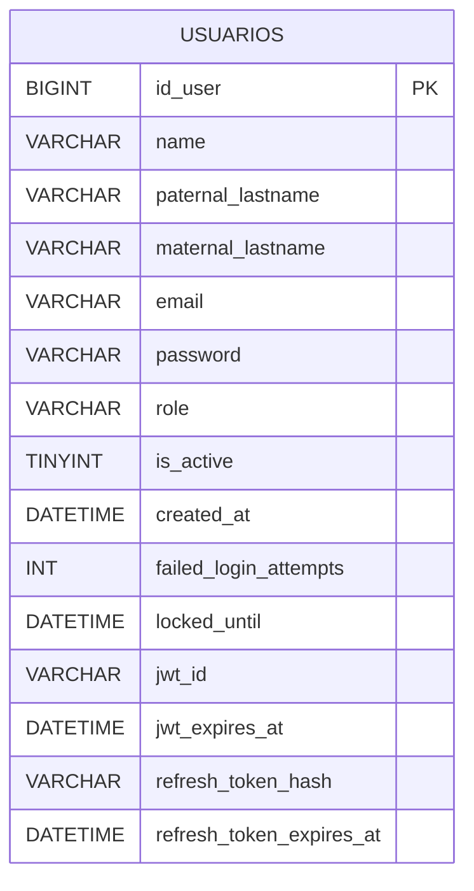

# Microservicio Users

Encargado de la **gestión de usuarios y autenticación** dentro de la plataforma de E-Commerce.

Administra el ciclo de vida de los usuarios, desde su registro hasta la actualización o eliminación de su cuenta y proporciona tokens de autenticación mediante JWT.

---

## Responsabilidades de Users

- Registro de usuarios.
- Consulta de usuarios.
- Actualización de información.
- Eliminación de usuarios.
- Inicio de sesión.
- Autenticación.
- Asignación de un role inicial.
- Generación de JWT para usuarios autenticados.

---

# Base de Datos

El microservicio `Users` utiliza una tabla principal:

```text
users
```

Su estructura es la siguiente:

| Campo               | Tipo           | Descripción                                                                       |
|---------------------|----------------|-----------------------------------------------------------------------------------|
| `id_user`           | `BIGINT(20)`   | Identificador único del usuario                                                   |
| `name`              | `VARCHAR(100)` | Nombre del usuario                                                                |
| `paternal_lastname` | `VARCHAR(100)` | Apellido paterno del usuario                                                      |
| `maternal_lastname` | `VARCHAR(100)` | Apellido materno del usuario                                                      |
| `email`             | `VARCHAR(150)` | Correo del usuario                                                                |
| `password`          | `VARCHAR(255)` | Contraseña hasheada                                                               |
| `role`              | `VARCHAR(45)`  | Rol del usuario: `ADMINISTRADOR`, `USUARIO`, `CLIENTE`, `VENDEDOR` y `REPARTIDOR` |
| `is_active`         | `TINYINT(1)`   | Indicador del estado del usuario: `1 : ACTIVO` y `0 : BORRADO` <br/>              |
 `created_at`        | `DATETIME`     | Fecha de creación del usuario: `YYYY-MM-DD HH:MM:SS`<br/><br/>                    |
`failed_login_attempts`| `INT`          | Intentos fallidos de login consecutivos                                           | `created_at`        | `DATETIME`   | Fecha de creación del usuario: `YYYY-MM-DD HH:MM:SS`<br/><br/>                    |
`locked_until`| `DATETIME`     | Fecha UTC de expiración del bloqueo del usuario                                   |
| `jwt_id` | `VARCHAR(36)` | Identificador del JWT vigente del usuario |
| `jwt_expires_at` | `DATETIME(6)` | Fecha UTC de expiración del JWT |
| `refresh_token_hash` | `VARCHAR(64)` | Hash SHA-256 del refresh token vigente |
| `refresh_token_expires_at` | `DATETIME(6)` | Fecha UTC de expiración del refresh token |
---

## Diagrama de Base de Datos



---

# API REST

Se exponen los siguientes endpoints:

| Método  | Endpoint                     | Descripción                                                      |
|---------|------------------------------|------------------------------------------------------------------|
| `POST`  | `/api/auth/login`            | Iniciar sesión y generar JWT                                     |
| `POST`  | `/api/auth/refresh` | Renovar el JWT y el refresh token mediante un refresh token vigente |
| `POST`  | `/api/users`                 | Registrar un nuevo usuario                                       |
| `GET`   | `/api/users/{id}`            | Consultar un usuario                                             |
| `GET`   | `/api/users/all`             | Consultar todos los usuarios                                     |
| `GET`   | `/api/users/active`          | Consultar un usuario por isActive                                |
| `GET`   | `/api/users/{id}/isActive`   | Consultar todos los usuarios por isActive                        |
| `GET`   | `/api/users/role`            | Consultar todos los usuarios por Rol                             |
| `GET`   | `/api/auth/users/{id}/authenticated` | Consultar si un usuario está autenticado                         |
| `PUT`   | `/api/users/{id}/role`       | Actualizar Rol de un usuario                                     |
| `PUT`   | `/api/users/{id}`            | Actualizar información de un usuario                             |
| `PATCH` | `/api/users/{id}/deactivate` | Desactivar un usuario                                            |
| `PATCH` | `/api/users/{id}/activate`   | Activar un usuario                                               |
| `PATCH` | `/api/auth/password`         | Cambiar password                                                 |

---

# Inicialización del proyecto

### 1. Requisitos
- Java 17+
- MySQL 8.0+
- Git

### 2. Clonar el repositorio

```bash
git clone <URL_DEL_REPOSITORIO>
cd user-service
```

### 3. Configurar variables de entorno

Crear el archivo `.env` a partir de `.env.example`:

```bash
cp .env.example .env
```

Configurar las credenciales:

```dotenv
# Production
DB_URL_PROD=jdbc:mysql://HOST:3306/ecommerce
DB_USERNAME_PROD=TU_USERNAME
DB_PASSWORD_PROD=TU_PASSWORD

# Local
DB_URL_LOCAL=jdbc:mysql://localhost:3306/ecommerce
DB_USERNAME_LOCAL=TU_USERNAME
DB_PASSWORD_LOCAL=TU_PASSWORD
```

### 4. Ejecutar el proyecto

Cargar variables de entorno (Bash/WSL):

```bash
set -a
source .env
set +a
```
**Windows (PowerShell)**

Cargar las variables de entorno desde `.env`:

```powershell
Get-Content .env | Where-Object { $_ -match '^\s*[^#\s][^=]*=' } | ForEach-Object {
    $key, $value = $_ -split '=', 2
    [Environment]::SetEnvironmentVariable($key.Trim(), $value.Trim(), 'Process')
}
```

Iniciar con Maven Wrapper y el perfil local:

```bash
./mvnw spring-boot:run -Dspring-boot.run.profiles=local
```

**Base URL:** `http://localhost:8080`

